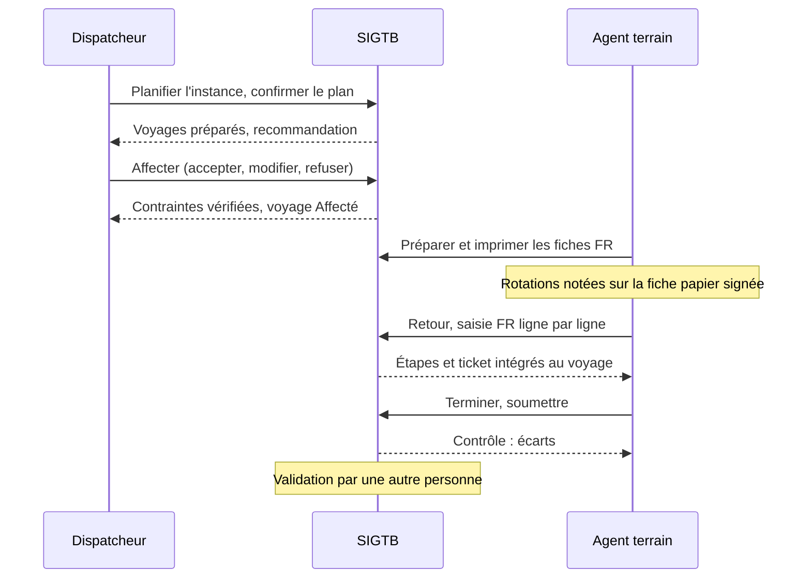
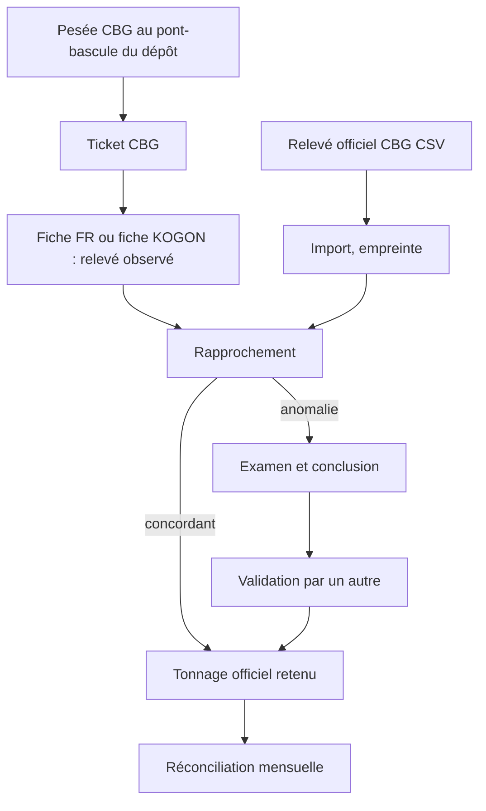
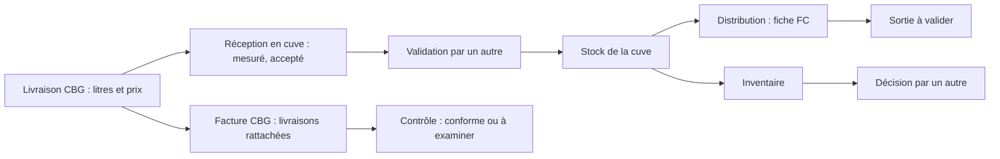
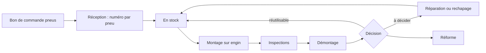
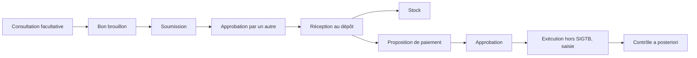
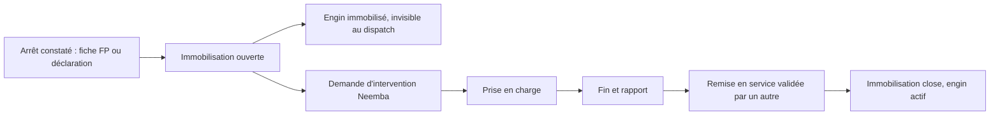
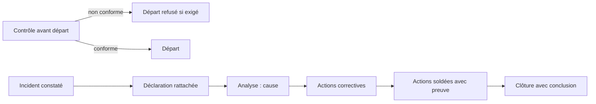
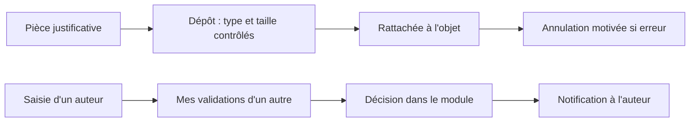
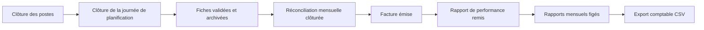

# SIGTB : guide des circuits opérationnels

Version SIGTB documentée : `origin/main` 1896cde (2026-11-17). Production constatée : release 31f7267. Date de rédaction : 2026-11-17 (`date -u`). Mission D-092, phase 1.

Chaque circuit décrit un processus de bout en bout tel que SIGTB le réalise. Les étapes absentes de l'application sont signalées « hors SIGTB » ou « non disponible ». Renvois : MGU = manuel général, chapitre.section.procédure.

---

## A. Transport complet (de l'objectif à l'encaissement)

```mermaid
flowchart LR
  A1[Objectif du jour] --> A2[Poste ouvert]
  A2 --> A3[Plan de shift confirmé]
  A3 --> A4[Affectation]
  A4 --> A5[Voyage exécuté]
  A5 --> A6[Ticket CBG et relevé]
  A6 --> A7[Rapprochement]
  A7 --> A8[Réconciliation clôturée]
  A8 --> A9[Facture signée et émise]
  A9 --> A10[Encaissement]
```

| Rubrique | Contenu |
|---|---|
| Acteurs | Responsable des opérations, chef de poste, dispatcheur, chauffeur (hors SIGTB), agent terrain, contrôleur, chargé de contrats, directeur, comptable |
| Déclencheur | Besoin de production d'une journée sur un site |
| Données | Objectif, shift, engins, chauffeurs, voyages, tickets CBG, relevé CBG, contrat et tarif à la tonne |
| Étapes | 1 Définir l'objectif (MGU 9.F.1). 2 Ouvrir le poste (10.F.1). 3 Préparer le shift (11.F.1). 4 Affecter (11.F.2, 11.F.3). 5 Exécuter le voyage (12.F.2) et saisir la fiche FR (14.F.4). 6 Importer le relevé CBG (15.F.1). 7 Rapprocher et traiter les anomalies (15.F.4, 15.F.5). 8 Réconcilier le mois (28.F.1). 9 Générer, soumettre, signer, émettre (28.F.2 à 28.F.4). 10 Encaisser (28.F.6). |
| Contrôles | Contraintes du dispatch ; cycle du voyage ; ticket unique ; tolérance de pesée ; anomalies bloquantes de réconciliation ; un voyage dans une seule réconciliation |
| Validations | Clôture de poste par une autre personne ; clôture d'anomalie par un validateur distinct ; signature par le directeur, jamais le préparateur |
| Résultat | Facture `FAC-AAAA-NNNN` dont chaque ligne remonte aux voyages, tickets et relevés |
| Exceptions | Voyage sans ticket (12.F.5) ; écart de pesée (15.F.5) ; ticket rectifié non facturable ; facture erronée (avoir, 28.F.5) |

---

## B. Dispatch, voyage, rotation, fiche

| Rubrique | Contenu |
|---|---|
| Acteurs | Dispatcheur, chef de poste, agent terrain, contrôleur |
| Déclencheur | Ouverture d'un shift |
| Données | Instance de shift, besoin, voyages, recommandation, fiche FR |
| Étapes | 1 Planifier l'instance et confirmer le plan (11.F.1). 2 Affecter (11.F.2). 3 Préparer, imprimer, remettre les FR (14.F.1 à 14.F.3). 4 Exécution sur le terrain (hors SIGTB, fiche papier). 5 Retour et saisie (14.F.4). 6 Terminer, soumettre, contrôler, valider (14.F.7, 14.F.8). 7 Enchaîner les voyages au fil du shift (12.F.6). 8 Clôturer le shift et le poste (11.F.6, 10.F.3). |
| Contrôles | Engin disponible, chauffeur habilité, site ouvert ; ordre des étapes ; écarts FR (voyage sans ligne, ticket absent, km) |
| Validations | Validation de la fiche par une autre personne que l'auteur de la saisie ; validation de la clôture de poste |
| Résultat | Voyages exécutés et documentés ; fiche validée et archivée |
| Exceptions | Voyage suspendu (11.F.4) ; voyage interrompu (12.B) ; fiche renvoyée en correction ; fiche annulée (14.F.9) |

---

## C. Pesée officielle CBG, fiche KOGON, rapprochement

| Rubrique | Contenu |
|---|---|
| Acteurs | CBG (pesée, hors SIGTB), agent KOGON, contrôleur, validateur finance |
| Déclencheur | Arrivée d'un camion au dépôt ; réception du relevé périodique CBG |
| Données | Ticket, brut, tare, net en tonnes, camion, chauffeur ; relevé CSV ; tolérance |
| Étapes | 1 Recopier la pesée observée (14.F.4 ou 15.F.3). 2 Importer le relevé CBG (15.F.1) et joindre l'original. 3 Rapprocher (15.F.4). 4 Examiner, conclure, soumettre (15.F.5). 5 Valider ou renvoyer. 6 Réconcilier (28.F.1). |
| Contrôles | Ticket, date et poids obligatoires ; empreinte unique ; ticket dupliqué ; camion non reconnu ; écart hors tolérance |
| Validations | Clôture d'anomalie par une personne distincte de celles qui ont conclu et soumis |
| Résultat | Tonnage CBG officiel rattaché au voyage, utilisable en réconciliation |
| Exceptions | Relevé importé par erreur (15.F.2) ; erreur CBG signalée (contestation hors SIGTB) ; ticket rectifié (15.F.6) ; sans relevé CBG (ligne bloquante forçable par décision motivée) |

---

## D. Carburant : livraison CBG, réception cuve, validation, distribution, inventaire, facture

| Rubrique | Contenu |
|---|---|
| Acteurs | CBG (livreur, hors SIGTB), logisticien, responsable carburant, agent distributeur |
| Déclencheur | Livraison de carburant par CBG |
| Données | Référence, litres, prix ; volumes mesuré et accepté ; pleins ; inventaires |
| Étapes | 1 Enregistrer la livraison et joindre le bon (20.F.2). 2 Réceptionner en cuve (20.F.4). 3 Valider l'entrée (20.F.7). 4 Distribuer par fiche FC (14.F.6) ou plein isolé (20.F.1). 5 Valider les sorties. 6 Inventorier et décider (20.F.6). 7 Enregistrer et contrôler la facture CBG (20.F.2). |
| Contrôles | Cuve du site, volume accepté au plus mesuré, motif d'écart ; stock sans données avant inventaire d'ouverture ; inventaire refusé si des mouvements attendent |
| Validations | Mouvements et inventaires validés par une autre personne |
| Résultat | Stock par cuve, consommation valorisée au prix réel, facture contrôlée |
| Exceptions | Écart de réception (motif) ; écart d'inventaire (ajustement validé, alerte si seuil) ; mouvement erroné (contre-mouvement) ; livraison ou facture mal saisie : pas de correction tracée (non disponible) |

---

## E. Pneus : de l'acquisition à la réforme

| Rubrique | Contenu |
|---|---|
| Acteurs | Acheteur, approbateur, magasinier, responsable de flotte, chef de maintenance |
| Déclencheur | Besoin de pneus |
| Données | Marque, modèle, numéro, prix, compteurs, profondeur, pression |
| Étapes | 1 Bon de commande (24.F.1). 2 Réception avec numéros (24.F.2) ou entrée manuelle. 3 Montage (22.F.1). 4 Inspections. 5 Démontage motivé. 6 Réparation, rechapage ou réforme. |
| Contrôles | Un pneu par position ; seul un pneu démonté se rechape ; plafond de rechapages ; opérations datées dans l'ordre |
| Validations | Approbation du bon ; aucune validation sur les opérations de pneu |
| Résultat | Coût au kilomètre par pneu, performance par marque et modèle |
| Exceptions | Annulation de la réception (tant que les pneus n'ont que leur entrée) ; annulation de la dernière opération ; cycle de vie complet D-091 non disponible à l'écran |

---

## F. Achat, commande, réception, facture, paiement

| Rubrique | Contenu |
|---|---|
| Acteurs | Demandeur, acheteur, approbateur (administrateur, directeur, comptable), magasinier, comptable |
| Déclencheur | Besoin d'un article ou d'un service |
| Données | Fournisseur, dépôt, lignes, taxes, réception, montant, référence bancaire |
| Étapes | 1 Consultation (25.F.3, facultatif). 2 Rédiger et soumettre (24.F.1). 3 Approuver. 4 Réceptionner. 5 Proposer le paiement (29.F.1). 6 Approuver. 7 Virement hors SIGTB, saisie de l'exécution. 8 Contrôle. |
| Contrôles | Réception au plus la commande ; reste à payer calculé par le serveur ; montant égal à l'offre retenue pour un bon issu de consultation |
| Validations | Approbation du bon et du paiement par une autre personne ; contrôle par une troisième personne |
| Résultat | Stock entré au prix commandé ; dette soldée |
| Exceptions | Rejet motivé ; annulation de réception ; solde d'un reliquat. Facture d'achat et rapprochement à trois voies : non disponibles (le paiement se fonde sur le bon reçu) |

---

## G. Maintenance et immobilisation

| Rubrique | Contenu |
|---|---|
| Acteurs | Agent de pointage, chef de maintenance, technicien Neemba (hors SIGTB), validateur |
| Déclencheur | Panne, maintenance planifiée, accident, pneumatique, attente de pièce |
| Données | Engin, début, cause, imputation, délai contractuel, rapport |
| Étapes | 1 Déclarer (21.F.1) ou saisir l'arrêt sur la FP (14.F.5). 2 Demander l'intervention (21.F.2). 3 Prise en charge. 4 Fin. 5 Remise en service validée. 6 Contrôle de la facture Neemba (27.F.8). |
| Contrôles | Une immobilisation ouverte par engin ; pas de chevauchement ; intervention refusée si l'imputation est l'exploitant |
| Validations | Remise en service par une autre personne que l'auteur de la fin |
| Résultat | Heures d'arrêt par imputation ; engin de nouveau disponible |
| Exceptions | Refus de la remise (retour à la prise en charge) ; correction ou annulation motivée ; alerte immobilisation longue (si seuil) ; retard non évalué sans délai saisi |

---

## H. Incidents et sécurité

| Rubrique | Contenu |
|---|---|
| Acteurs | Chauffeur et agent (contrôle), responsable HSE, responsables d'actions |
| Déclencheur | Prise de poste (contrôle) ; incident, accident, presque-accident |
| Données | Réponses aux points ; type, gravité, description, rattachement ; actions |
| Étapes | 1 Contrôle avant départ (30.F.1). 2 Déclarer l'incident (30.F.3, ou depuis le voyage). 3 Analyser. 4 Ajouter et solder les actions. 5 Clôturer. 6 Prévention : EPI, risques, plans, inspections (30.F.4). |
| Contrôles | Observation obligatoire sur un point non conforme ; clôture refusée avec une action ouverte |
| Validations | Signature d'un plan de prévention par un approbateur distinct |
| Résultat | Incident clos, actions tracées ; départ bloqué si le contrôle est exigé et non conforme |
| Exceptions | Exigence du contrôle inactive par défaut ; alertes action en retard, EPI échu, inspection en retard ; pas de photo jointe |

---

## I. Documents et workflows

| Rubrique | Contenu |
|---|---|
| Acteurs | Tout utilisateur qui saisit ; validateurs |
| Déclencheur | Saisie à justifier ; saisie à valider |
| Données | Fichier (PDF, JPEG, PNG, WebP ; CSV et XLSX pour un relevé CBG ; 10 Mio) ; éléments de Mes validations |
| Étapes | 1 Joindre la pièce (MGU 3.F.4). 2 Ouvrir Mes validations (5.F.1). 3 Décider dans le module. 4 Lire les notifications (5.F.2). |
| Contrôles | Type et taille vérifiés après dépôt ; séparation des tâches |
| Validations | Celles de chaque module |
| Résultat | Pièce rattachée ; décision tracée ; notification |
| Exceptions | Pièces possibles sur cinq types d'objets seulement ; documents des engins sans fichier ; pas de relance automatique |

---

## J. Reporting et clôture

| Rubrique | Contenu |
|---|---|
| Acteurs | Chefs de poste, responsable des opérations, chargé de contrats, comptable, directeur |
| Déclencheur | Fin de shift, de journée, de mois |
| Données | Bilans de poste, causes d'écart, réconciliation, rapports |
| Étapes | 1 Clôturer et valider les postes (10.F.3). 2 Clôturer la journée (9.F.4). 3 Valider et archiver les fiches (14.F.8). 4 Réconcilier et facturer (28.F.1 à 28.F.3). 5 Rapport de performance (27.F.5). 6 Figer les rapports (32.F.1). 7 Exporter pour la comptabilité (29.F.3). |
| Contrôles | Cause d'écart obligatoire ; ligne à examiner bloquante ; rapport figé immuable |
| Validations | Clôtures validées par d'autres personnes ; signature du directeur |
| Résultat | Période close et justifiée |
| Exceptions | Annulation motivée d'une clôture de planification ; avoir après émission ; pas de clôture comptable formelle dans SIGTB |
