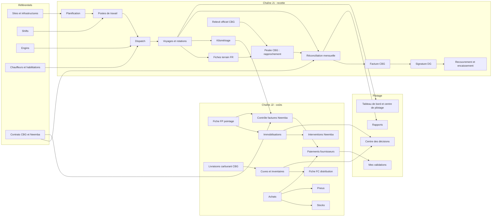

# Cartographie fonctionnelle de SIGTB

Version SIGTB documentée : `origin/main` 1896cde (2026-11-17). Production constatée : release 31f7267. Date de rédaction : 2026-11-17 (`date -u`). Mission D-092, phase 1.

Modules relevés dans `src/components/Layout/menu.ts` (entrées du menu) et `src/App.tsx` (écrans réellement ouverts). Les statuts détaillés sont dans `CATALOGUE_FONCTIONNALITES.md`.

## 1. Schéma général des flux métier

Figure C.1 (capture à venir) : version imprimable du schéma, à produire en phase 3 à partir de ce code Mermaid.

## 2. Fiches des modules

Légende des droits : code du module (voir `00_INDEX.md`, section 3).

### 2.1 Tableau de bord et centre de pilotage
| Rubrique | Contenu |
|---|---|
| Finalité | Lire les indicateurs de l'exploitation avec leur source, leur période, leur fiabilité et leur heure de calcul. |
| Utilisateurs | Tous les comptes qui lisent `dashboard` ; direction en priorité. |
| Entrées | Voyages, objectifs, postes, engins, immobilisations, carburant, achats (lus par `indicateurs_pilotage`). |
| Opérations | Filtrer (site, shift, véhicule, partenaire), comparer deux périodes, exporter en CSV, imprimer. |
| Sorties | Indicateurs affichés et fichier CSV. |
| Validations | Aucune (lecture). |
| Dépendances | Tous les modules de la chaîne J1 et J2. |

### 2.2 Mes validations et notifications
| Rubrique | Contenu |
|---|---|
| Finalité | Lister, pour chaque utilisateur, les décisions qui l'attendent, et ses notifications. |
| Utilisateurs | Tous. |
| Entrées | Bons de commande, paiements, mouvements et inventaires carburant, clôtures de poste, remises en service, factures à signer, actions correctives, plans de prévention, échéances de contrat, clauses, budgets dépassés. |
| Opérations | Ouvrir l'écran où la décision se prend ; marquer les notifications lues. |
| Sorties | Liste calculée à la lecture (rien n'est stocké). |
| Validations | Aucune ici : la décision se prend dans le module. |
| Dépendances | Achats, Paiements, Carburant, Postes, Maintenance, Facturation, HSE, Contrats, Budgets. |

### 2.3 Centre des décisions
| Rubrique | Contenu |
|---|---|
| Finalité | Regrouper les alertes calculées par le serveur et les décisions en attente, par priorité. |
| Utilisateurs | Lecteurs du module de chaque règle. |
| Entrées | Neuf règles : immobilisation longue, intervention Neemba en retard, contrôle avant départ non conforme, écart d'inventaire carburant, document ou habilitation expiré, action corrective en retard, voyage livré sans ticket CBG, EPI à renouveler, inspection en retard. |
| Opérations | Prendre en compte, résoudre avec motif. |
| Sorties | Registre des alertes (`alerts`) écrit par `actualiser_alertes`. |
| Validations | Résolution motivée par un titulaire de l'écriture du module. |
| Dépendances | Maintenance, Carburant, HSE, Flotte, Voyages ; réglages de seuils (Paramètres). |

### 2.4 Sites, infrastructures et fermetures
| Rubrique | Contenu |
|---|---|
| Finalité | Tenir le référentiel des sites miniers et dépôts, leurs infrastructures et leurs fermetures. |
| Utilisateurs | Administrateur, titulaires de `settings`. |
| Entrées | Nom, type, organisation, coordonnées facultatives, responsable, capacité ; infrastructures et périodes de fermeture. |
| Opérations | Créer, modifier, désactiver un site ; déclarer une infrastructure ; déclarer et lever une fermeture. |
| Sorties | Sites disponibles pour la planification, le dispatch, les voyages, les comptes. |
| Validations | Fermeture motivée ; levée anticipée datée et motivée. |
| Dépendances | Organisations (Paramètres) ; utilisé par presque tous les modules (périmètre site). |

### 2.5 Shifts
| Rubrique | Contenu |
|---|---|
| Finalité | Définir les plages de travail communes à tous les sites (par exemple jour et nuit). |
| Utilisateurs | Administrateur ou titulaire de `settings`, profil sans site. |
| Entrées | Nom, libellé, heure de début, heure de fin, ordre. |
| Opérations | Créer, modifier (motif), désactiver (motif). |
| Sorties | Shifts proposés aux objectifs, postes, dispatch et fiches. |
| Validations | Chevauchement de deux shifts actifs refusé. |
| Dépendances | Aucune en amont ; Planification, Postes, Dispatch, Fiches en aval. |

### 2.6 Planification
| Rubrique | Contenu |
|---|---|
| Finalité | Fixer l'objectif de production (tonnes, voyages, engins) par date, site et shift, et le suivre. |
| Utilisateurs | Titulaires de `planning`. |
| Entrées | Objectif, ventilation par destination ou contrat, causes d'écart. |
| Opérations | Définir, réviser, annuler, ventiler, simuler, clôturer la journée, comparer les shifts. |
| Sorties | Objectif versionné, réalisé calculé, rapport de production figé. |
| Validations | Révision et annulation motivées ; clôture séparée si le réglage l'exige. |
| Dépendances | Sites, Shifts, Voyages (réalisé), Contrats (ventilation). |

### 2.7 Postes de travail
| Rubrique | Contenu |
|---|---|
| Finalité | Instance d'un shift pour une date et un site : équipe, présence, événements, consignes, bilan. |
| Utilisateurs | Chefs de poste (`trips`) ; validation par `planning`. |
| Entrées | Équipe (chauffeurs, engins), pointage, événements, consignes de sortie. |
| Opérations | Planifier, ouvrir, démarrer, consigner, clôturer, valider la clôture, annuler (motif). |
| Sorties | Bilan de poste figé, rapport imprimable, consignes du poste suivant. |
| Validations | Clôture validée par une autre personne. |
| Dépendances | Shifts, Chauffeurs, Engins ; alimente Dispatch et Rapports. |

### 2.8 Dispatch
| Rubrique | Contenu |
|---|---|
| Finalité | Préparer les voyages du shift et décider l'affectation camion, chauffeur, engin de chargement. |
| Utilisateurs | Dispatcheurs (`trips`). |
| Entrées | Objectif, instance de shift, engins disponibles, chauffeurs habilités, fermetures. |
| Opérations | Planifier l'instance, confirmer le plan, recevoir la recommandation, affecter (seul ou en groupe), suspendre, reprendre, clôturer le shift, simuler. |
| Sorties | Voyages préparés et affectés, journal des décisions. |
| Validations | Contraintes serveur (engin actif, chauffeur habilité, permis, site ouvert, pas de double affectation) ; motif pour modifier ou refuser. |
| Dépendances | Planification, Postes, Flotte, Chauffeurs, Habilitations, Immobilisations, Sites. |

### 2.9 Voyages et rotations
| Rubrique | Contenu |
|---|---|
| Finalité | Suivre l'exécution de chaque voyage de bout en bout (objet central de la chaîne). |
| Utilisateurs | Exploitation (`trips`). |
| Entrées | Étapes horodatées, pesée et ticket CBG, incidents, pièces justificatives. |
| Opérations | Créer, avancer le cycle, rattacher un ticket, enchaîner, vérifier un événement, déclarer un incident, rapports par axe. |
| Sorties | Journal `trip_events` immuable, voyages livrés pour la réconciliation. |
| Validations | Transitions contrôlées ; vérification d'événement par une autre personne. |
| Dépendances | Dispatch (affectation), Fiches, Pesée CBG, Kilométrage, Incidents. |

### 2.10 Kilométrage
| Rubrique | Contenu |
|---|---|
| Finalité | Établir des kilomètres vérifiables : référence, déclarée, mesurée, validée, facturable. |
| Utilisateurs | Exploitation (relevés, `trips`), chargé de contrats (validation, `contracts`). |
| Entrées | Distances de référence, relevés de compteur, photo du compteur. |
| Opérations | Saisir, corriger (motif), valider la distance. |
| Sorties | Distance validée par voyage. |
| Validations | Validation par une autre personne que l'auteur des relevés. |
| Dépendances | Voyages ; utilisée par le contrôle des factures Neemba (tarif au km). |

### 2.11 Fiches terrain
| Rubrique | Contenu |
|---|---|
| Finalité | Fiches papier numérotées (FR rotations, FP pointage des engins, FC carburant), preuve signée des heures et tonnages. |
| Utilisateurs | Agents terrain, contrôleurs ; droits `trips`, `maintenance`, `fuel` selon le type. |
| Entrées | Fiche signée retournée. |
| Opérations | Préparer, imprimer, remettre, retourner, saisir, terminer, soumettre, contrôler, renvoyer, valider, archiver, annuler. |
| Sorties | Étapes de voyages, pointages, immobilisations, distributions carburant, écarts de contrôle. |
| Validations | Validation par une autre personne que l'auteur de la saisie ; motif si écarts. |
| Dépendances | Dispatch (voyages), Engins, Cuves ; alimente Voyages, Immobilisations, Carburant, Pesée. |

### 2.12 Pesée CBG
| Rubrique | Contenu |
|---|---|
| Finalité | Conserver séparément la pesée officielle CBG et le relevé observé KOGON, puis les rapprocher. |
| Utilisateurs | Agent KOGON, contrôleur (`trips`), validateur (`invoices`). |
| Entrées | Relevé CBG en CSV, fiches KOGON, tolérance. |
| Opérations | Importer, annuler un relevé, saisir une fiche KOGON, rapprocher, examiner et décider les anomalies. |
| Sorties | Tonnage officiel par voyage, anomalies, décisions. |
| Validations | Clôture d'anomalie par une autre personne que celles qui ont conclu et soumis. |
| Dépendances | Voyages, Fiches ; alimente Réconciliation. |

### 2.13 Opérations transport
| Rubrique | Contenu |
|---|---|
| Finalité | Vue transverse de la chaîne transport : journal des événements, anomalies, contrôles. |
| Utilisateurs | Exploitation (`trips`). |
| Entrées | Journaux existants (voyages, dispatch, fiches, tickets, rapprochements, pièces). |
| Opérations | Lire, filtrer, ouvrir la fiche du voyage, vérifier un événement. |
| Sorties | Constats de contrôle sans écriture. |
| Validations | Vérification d'un événement par une autre personne. |
| Dépendances | Dispatch, Voyages, Fiches, Pesée. |

### 2.14 Flotte : engins, chauffeurs, documents
| Rubrique | Contenu |
|---|---|
| Finalité | Référentiels des engins, des chauffeurs, de leurs habilitations, infractions et documents. |
| Utilisateurs | Responsable de flotte (`vehicles`, `drivers`). |
| Entrées | Fiches engin et chauffeur, habilitations, documents, infractions. |
| Opérations | Créer, modifier, suspendre, remettre en service, réformer ; habiliter, révoquer ; sanctionner. |
| Sorties | Disponibilités utilisées par le dispatch ; alertes d'expiration. |
| Validations | Sanction par un titulaire de l'approbation `drivers`. |
| Dépendances | Sites, Contrats (rattachement location). |

### 2.15 Carburant
| Rubrique | Contenu |
|---|---|
| Finalité | Tracer le carburant reçu de CBG, stocké, distribué et inventorié, et le valoriser au prix réel. |
| Utilisateurs | Logisticien, responsable carburant (`fuel`). |
| Entrées | Livraisons et factures CBG, réceptions, transferts, fiches FC, pleins, inventaires. |
| Opérations | Enregistrer, réceptionner, transférer, distribuer, inventorier, valider, annuler, analyser. |
| Sorties | Stock par cuve, consommation par tonne et par heure, anomalies. |
| Validations | Mouvements et inventaires validés par une autre personne. |
| Dépendances | Sites, Engins, Fiches FC ; alimente Coûts et Centre des décisions. |

### 2.16 Maintenance et immobilisations
| Rubrique | Contenu |
|---|---|
| Finalité | Tracer les arrêts des engins loués et les interventions de Neemba ; ordres de travail internes. |
| Utilisateurs | Chef de maintenance (`maintenance`). |
| Entrées | Immobilisations (aussi depuis les fiches FP), demandes d'intervention. |
| Opérations | Déclarer, clôturer, corriger, annuler ; demander, prendre en charge, terminer, valider la remise en service. |
| Sorties | Disponibilité des engins, heures d'arrêt par imputation. |
| Validations | Remise en service validée par une autre personne. |
| Dépendances | Engins, Fiches FP, Stocks (pièces) ; alimente Dispatch, Évaluation Neemba. |

### 2.17 Pneus
| Rubrique | Contenu |
|---|---|
| Finalité | Suivre chaque pneu de l'entrée en stock à la réforme, avec son coût au kilomètre. |
| Utilisateurs | Flotte et maintenance (`vehicles` ou `maintenance`). |
| Entrées | Réception d'achat ou entrée manuelle, montages, inspections. |
| Opérations | Monter, démonter, permuter, inspecter, réparer, rechaper, réformer, annuler la dernière opération. |
| Sorties | Pneus à surveiller, performance par marque. |
| Validations | Règles d'état (seul un pneu démonté se rechape, etc.). |
| Dépendances | Achats (réception), Engins. |

### 2.18 Stocks, achats, fournisseurs
| Rubrique | Contenu |
|---|---|
| Finalité | Acheter, réceptionner et tenir le stock magasin ; référencer et évaluer les fournisseurs. |
| Utilisateurs | Logisticien, acheteur (`stock`, `purchases`), approbateurs (approbation `purchases`). |
| Entrées | Bons de commande, consultations et offres, réceptions, mouvements, inventaires. |
| Opérations | Rédiger, soumettre, approuver, réceptionner, solder ; mouvementer, réserver, inventorier. |
| Sorties | Stock valorisé, bons payables. |
| Validations | Approbation du bon par une autre personne que le demandeur. |
| Dépendances | Fournisseurs, Dépôts, Maintenance (réservations) ; alimente Paiements, Pneus, Budgets. |

### 2.19 Moyens généraux et patrimoine
| Rubrique | Contenu |
|---|---|
| Finalité | Registre des biens non roulants (mobilier, équipements) et leur cycle. |
| Utilisateurs | Titulaires de `stock`. |
| Entrées | Biens, affectations, inventaires physiques. |
| Opérations | Enregistrer, affecter, transférer, restituer, réparer, réformer, inventorier. |
| Sorties | Registre et écarts d'inventaire. |
| Validations | Annulation motivée de la dernière opération. |
| Dépendances | Sites, Fournisseurs. |

### 2.20 Contrats et Neemba
| Rubrique | Contenu |
|---|---|
| Finalité | Dossier contractuel (CBG client, Neemba loueur), tarifs par engin, engagements, clauses, échéances ; contrôle des factures Neemba ; évaluation du loueur. |
| Utilisateurs | Chargé de contrats (`contracts`), direction. |
| Entrées | Contrats, versions, tarifs, engagements, clauses, factures Neemba reçues. |
| Opérations | Créer, avenant, mesurer, générer le rapport de performance, calculer et décider les clauses, contrôler, notifier, régulariser. |
| Sorties | Tarifs en vigueur, écarts de facture, rapports remis. |
| Validations | Renonciation à une clause par un approbateur distinct. |
| Dépendances | Engins, Fiches FP (heures), Kilométrage ; alimente Réconciliation, Facturation, Paiements. |

### 2.21 Réconciliation, facturation CBG, recouvrement
| Rubrique | Contenu |
|---|---|
| Finalité | Facturer à CBG le tonnage justifié, faire signer, émettre, encaisser, relancer. |
| Utilisateurs | Chargé de contrats, comptable (`invoices`), directeur (signature). |
| Entrées | Voyages livrés, tonnage officiel CBG, tarifs du contrat. |
| Opérations | Ouvrir, actualiser, décider les lignes, clôturer ; générer, soumettre, signer, émettre, avoir ; encaisser, relancer. |
| Sorties | Facture numérotée FAC-AAAA-NNNN, avoirs, créances. |
| Validations | Signature par le directeur, jamais le préparateur ; décision motivée des lignes. |
| Dépendances | Voyages, Pesée CBG, Contrats. |

### 2.22 Paiements, budgets, coûts
| Rubrique | Contenu |
|---|---|
| Finalité | Chaîne de décision des paiements fournisseurs (exécutés hors SIGTB), budgets, coûts directs, export comptable. |
| Utilisateurs | Comptable, direction (`invoices`, `costs`). |
| Entrées | Factures Neemba contrôlées, bons reçus, dépenses. |
| Opérations | Proposer, approuver, saisir l'exécution, contrôler ; budgéter, réviser ; enregistrer un coût. |
| Sorties | Reste à payer, suivi budgétaire, export CSV. |
| Validations | Approbation et contrôle a posteriori par d'autres personnes que le proposant. |
| Dépendances | Contrats, Achats. |

### 2.23 Santé, sécurité (HSE)
| Rubrique | Contenu |
|---|---|
| Finalité | Contrôle avant départ, incidents et actions correctives, EPI, risques, plans de prévention, inspections. |
| Utilisateurs | Exploitation et HSE (`trips`). |
| Entrées | Réponses aux points de contrôle, déclarations d'incident, dotations, programmes. |
| Opérations | Contrôler, déclarer, analyser, ajouter et solder une action, clôturer ; remettre un EPI, signer un plan, réaliser une inspection. |
| Sorties | Résultat du contrôle (bloquant si exigé), alertes. |
| Validations | Signature d'un plan par un approbateur distinct du rédacteur. |
| Dépendances | Voyages, Engins, Chauffeurs. |

### 2.24 Ressources humaines
| Rubrique | Contenu |
|---|---|
| Finalité | Employés, présences, paie (écrans hérités). |
| Utilisateurs | Titulaires de `hr`. |
| Entrées | Fiches employé, présences. |
| Opérations | Créer et modifier un employé ; saisir et annuler une présence ; paie partielle. |
| Sorties | Registre des présences. |
| Validations | Correction de présence motivée. |
| Dépendances | Chauffeurs (lien par matricule). |

### 2.25 Reporting et analyses
| Rubrique | Contenu |
|---|---|
| Finalité | Rapports client, loueur, shift, mensuel ; coût direct par tonne ; santé et fiabilité de la flotte ; performance des chauffeurs. |
| Utilisateurs | Lecteurs de `reports`. |
| Entrées | Données de tous les modules. |
| Opérations | Calculer, exporter en CSV, imprimer, figer. |
| Sorties | Rapports figés immuables. |
| Validations | Aucune. |
| Dépendances | Voyages, Facturation, Carburant, Maintenance. |

### 2.26 Suivi GPS, géorepérage, IoT, environnement
| Rubrique | Contenu |
|---|---|
| Finalité | Écrans prévus pour des capteurs et un suivi de position. |
| Utilisateurs | Lecteurs de `gps_tracking`, `iot`, `esg`. |
| Entrées | Aucune donnée aujourd'hui (aucun matériel installé). |
| Opérations | Lecture ; saisie de zones de géorepérage sans détection. |
| Sorties | « Sans données ». |
| Validations | Aucune. |
| Dépendances | Matériel à choisir (extension à déclencheur). |

### 2.27 Paramètres
| Rubrique | Contenu |
|---|---|
| Finalité | Comptes, droits, sites des comptes, délégations, journal de connexion, référentiels, fiche société, réglages serveur. |
| Utilisateurs | Administrateur. |
| Entrées | Comptes, attributions, réglages. |
| Opérations | Voir le manuel administrateur. |
| Sorties | Droits effectifs appliqués par le serveur. |
| Validations | Motif obligatoire pour tout changement de droit, de site ou de statut de compte. |
| Dépendances | Tous les modules. |
